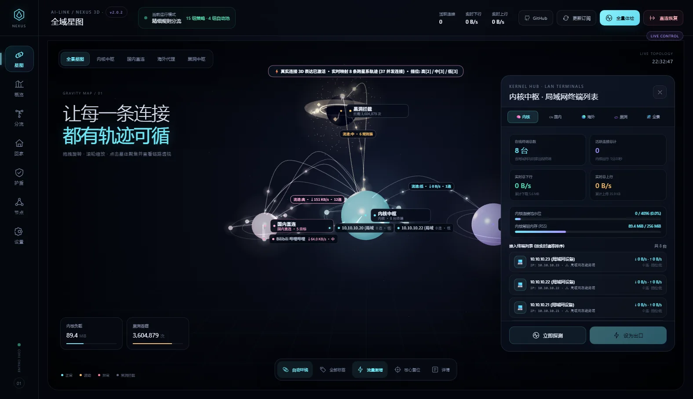
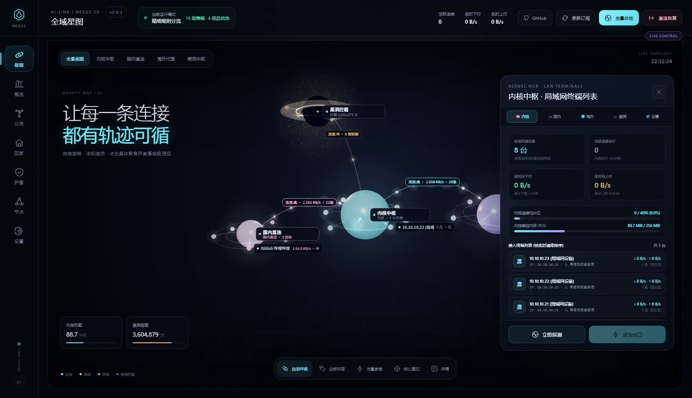
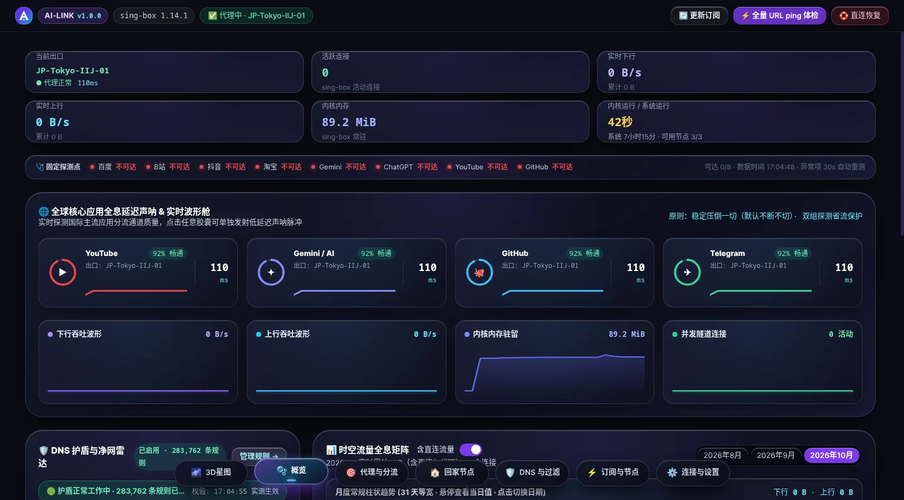
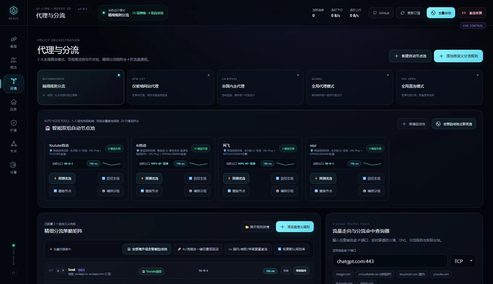
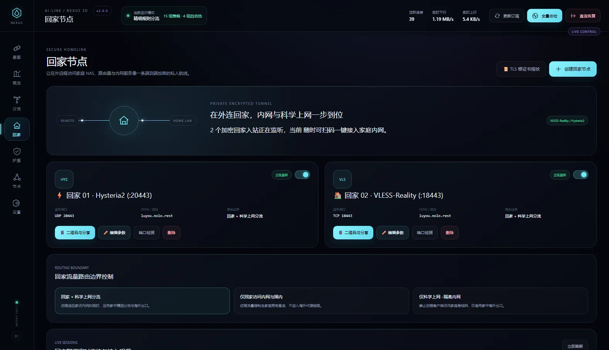
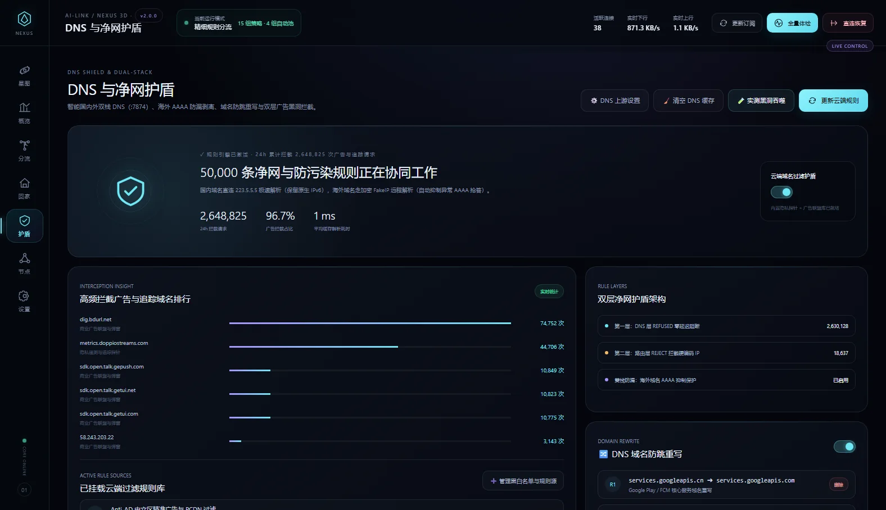
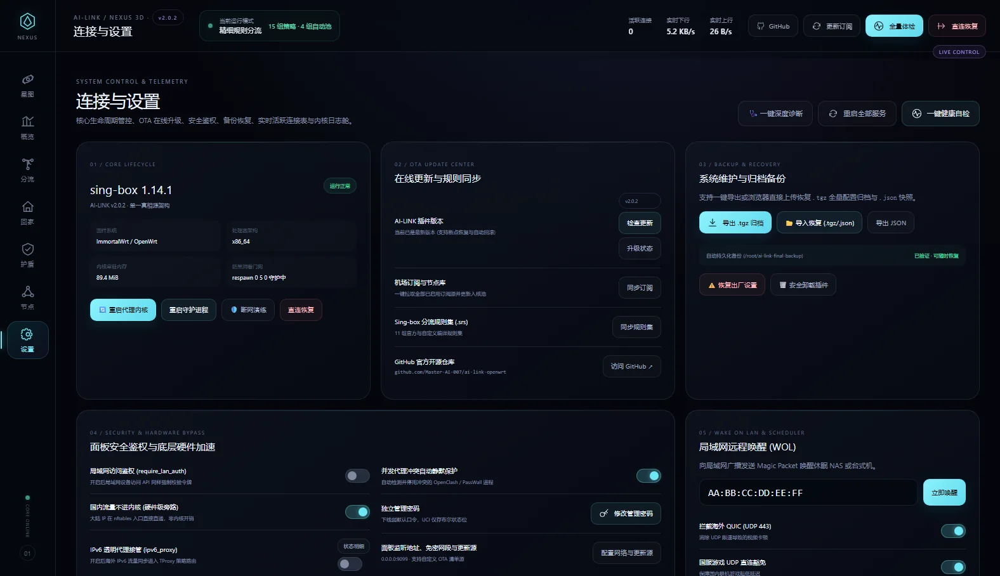
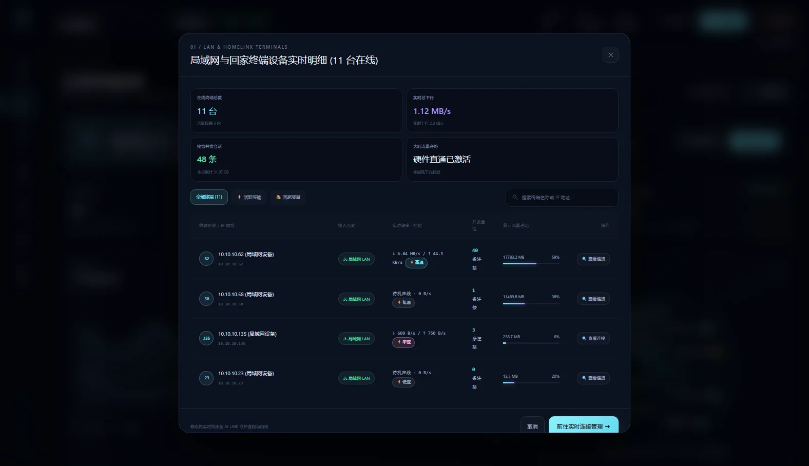
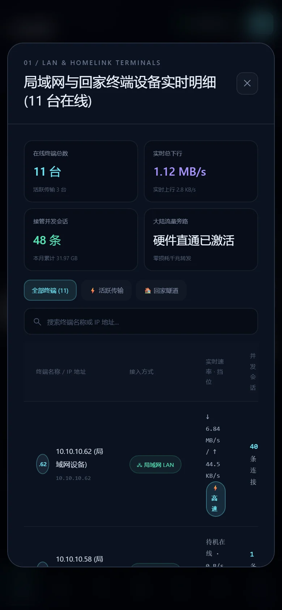

<div align="center">

# AI-LINK

**NEXUS 全域 3D 智能网关 · 运行在 OpenWrt 上的智能分流系统**

[](https://github.com/Master-AI-007/ai-link-openwrt/releases/tag/v2.0.0)
[](#环境要求)
[](#技术架构)
[](#许可与免责)

[官网](https://ai-link-official.pages.dev) · [更新日志](https://ai-link-official.pages.dev/changelog) · [Releases](https://github.com/Master-AI-007/ai-link-openwrt/releases) · [使用手册](docs/manual-v1.0.0.md)



</div>

---

## 这是什么

AI-LINK 是一套面向 OpenWrt 的**智能分流网关**：用 sing-box 单内核接管全屋流量，按 AI / 流媒体 / 社交 / 国内 / 游戏等 15 组策略精细分流，
再叠一层双层 DNS 净网与加密回家隧道，并把这一切画成一张**能看见真实流量的 3D 星图**。

它不追求「功能最多」，只保证三件事：

- **看得见** —— 每条连接都能在星图上找到轨迹，延迟/吞吐/命中规则全部真实；
- **分得清** —— 15 组策略独立出口，四阶走向查询能解释任意一个域名的最终去向；
- **断不了** —— 内核崩溃自动拉起、黑洞残留自动拆除、停机 DNS 自动回退。

---

## v2.0.0 新特性

| | 能力 | 说明 |
|---|---|---|
| 🪐 | **全域 3D 星图** | 内核中枢（青）/ 国内直连（淡粉 `#f9a8d4`）/ 海外代理（紫）/ 黑洞拦截（琥珀）四颗母星，节点为卫星，连线按真实吞吐流动 |
| ⚡ | **流量激增 = 真实连接** | 点击后实时拉取活跃连接，生成 `终端 → 内核 → 母星 → 目标` 的跨星系弧线与流动光球，HUD 显示挡位分布 |
| 🌡 | **三挡流速引擎** | `computeSpeedGear(rateBps, conns)`：高 `0.56` / 中 `0.26` / 低 `0.095`，光球速度与体积随真实速率变化 |
| 📊 | **概览三卡可点开** | 终端 / 出站节点 / 目标分流三张卡片点击弹出实时明细（KPI、筛选、搜索、快捷操作） |
| 🛡 | **双层 DNS 净网** | DNS 层 `REFUSED` + 路由层 `REJECT`，50,000 条规则，拦截数与占比真实统计 |
| 🏠 | **回家隧道** | Hysteria2 与 VLESS-Reality 双协议，二维码 / 标准链接导入，三种回家路由边界 |

---

## 界面一览

<div align="center">

| 01 全域星图 | 02 网络概览 | 03 代理与分流 |
|---|---|---|
|  |  |  |

| 04 回家节点 | 05 DNS 与护盾 | 06 订阅与节点 |
|---|---|---|
|  |  |  |

| 07 连接与设置 | 终端明细弹窗 | 移动端 |
|---|---|---|
|  |  |  |

</div>

---

## 快速开始

### 环境要求

- OpenWrt **23.05+ / 24.10 / ImmortalWrt 25.x**，使用 `fw4` + `nftables`（`opkg` 与 `apk` 均可）
- 架构：`x86_64` / `aarch64` / `armv7` / `mipsel` / `riscv64`
- 至少 32 MB 可用空间；建议内存 ≥ 256 MB

### 安装

```sh
curl -fsSL https://ai-link-official.pages.dev/install.sh | sh
```

脚本会检测包管理器与架构、清理冲突的透明代理插件、下载并校验安装包，装完做进程与端口健康断言。

### 升级

```sh
ai-link update --apply          # 已安装用户，自动比对 version.json 并回滚保护
curl -fsSL https://ai-link-official.pages.dev/upgrade.sh | sh   # 或走升级脚本
```

### 自检

```sh
ai-link check                   # daemon / core / nft / 端口 / 出口连通性
ai-link status                  # 面板与内核概要
```

安装完成后浏览器打开 `http://<路由器IP>:9099`。

---

## 技术架构

```
LAN 客户端
   │  DNS → dnsmasq → 127.0.0.1:7874 (FakeIP 198.18.0.0/15)
   ▼
nftables (table inet ai_link)
   ├── TProxy  :7893   (TCP/UDP 透明代理)
   ├── redirect :7891  (DNS 劫持)
   └── MSS clamp / 保留地址直连
   ▼
sing-box 1.14.1（单内核）
   ├── 15 组 Shunt 选择器（AI / YouTube / TikTok / Netflix / Google / GitHub / 微软 / 苹果 / 游戏 …）
   ├── 自动节点池（1~5 组候选，按延迟与滑动评分择优）
   └── 出站：VLESS / Hysteria2 / Reality / 直连 / 黑洞 REJECT
```

- **分流判定**：域名后缀 + 关键词 + 精确匹配 + IP 段，逐组优先级从上到下匹配，未命中落到最终兜底组。
- **防掉线**：`respawn 0 5 0` 无限重试 + 15 秒进程看门狗 + 内核离线自动拆除 nft/策略路由/DNS 上游。
- **幂等重载**：规则指纹未变时只做热更新，不重启内核。

---

## 安全建议

- 面板默认信任局域网（`require_lan_auth=false`）。**若 9099 可能暴露到公网，请务必开启「强制内网登录」并修改初始密码。**
- 首页不向浏览器写入令牌 Cookie；`/api/status` 对非回环请求做凭据脱敏。
- 建议把面板监听绑定到内网网段，或只允许指定管理网段访问。

---

## 已知限制

- `v1.0.0` 没有 OTA 模块，需手动升级一次。
- 归档恢复的「空参数回退默认备份」与「导出包含面板令牌」两项待办，计划 2.0.x 收口。
- 入核配额上限 200，极端情况下会出现 `201 / 200` 的边界显示。

---

## 目录结构

```
.
├── ai-link-openwrt/          # 插件源码（安装包内容）
│   ├── root/usr/share/ai-link/
│   │   ├── ai-link-daemon.py # 面板与调度守护进程
│   │   ├── webui/            # NEXUS 前端（index.html / nexus.js / nexus3d.js / nexus.css）
│   │   └── nftables/         # 透明代理规则
│   ├── root/etc/init.d/ai-link
│   └── install.sh
├── public/                   # 官网（Cloudflare Pages）
│   ├── index.html  changelog.html  install.sh  upgrade.sh  version.json
│   ├── assets/               # 界面截图（webp）与站点样式
│   └── pkg/                  # 历史安装包镜像
├── docs/manual-v1.0.0.md     # 历史完整手册（架构、拓扑、逐页说明）
├── CHANGELOG.md              # 全量更新日志
└── RELEASE_NOTES.md          # 最新版本发布说明
```

---

## 版本与更新

| 版本 | 日期 | 主题 |
|---|---|---|
| **2.0.0** | 2026-10-27 | NEXUS 全域 3D 正式版（真实连接 3D / 三挡流速 / 三卡明细） |
| 1.0.3 | 2026-10-26 | 内核防掉线自愈 + 非分流模式选点修复 |
| 1.0.2 | 2026-10-26 | 全量修复与版本对齐 |
| 1.0.1 | 2026-10-26 | 安全与稳定性修复 |
| 1.0.0 | 2026-10-25 | 首个正式版 |

完整更新内容见 [CHANGELOG.md](CHANGELOG.md) 或 [官网更新日志](https://ai-link-official.pages.dev/changelog)。

---

## 包指纹

```
AI-LINK-v2.0.0.tar.gz
size   1,694,889 B
md5    7827f45b9039219c843a435a35411498
sha256 02ced20e70c0ced9cf831368c5f46c866dc0ea023afd0f1a15bea5e05ecf9a95
```

在线清单：<https://ai-link-official.pages.dev/version.json>

---

## 许可与免责

本项目采用 MIT 许可。

本项目仅用于**个人学习与自有网络管理**。请遵守所在国家/地区的法律法规与网络服务商条款，
不得用于任何违法用途。作者不对使用者的行为及其后果承担责任。
