<div align="center">

# AI-LINK

**NEXUS 全域 3D 智能网关 · 运行在 OpenWrt 上的新一代智能分流与网络系统**

[](https://github.com/Master-AI-007/ai-link-openwrt/releases/tag/v2.7.0)
[](#环境要求)
[](#技术架构)
[](#许可与免责)

[官网](https://ai-link-official.pages.dev) · [更新日志](https://ai-link-official.pages.dev/changelog) · [GitHub Releases](https://github.com/Master-AI-007/ai-link-openwrt/releases) · [使用手册](docs/manual-v1.0.0.md)

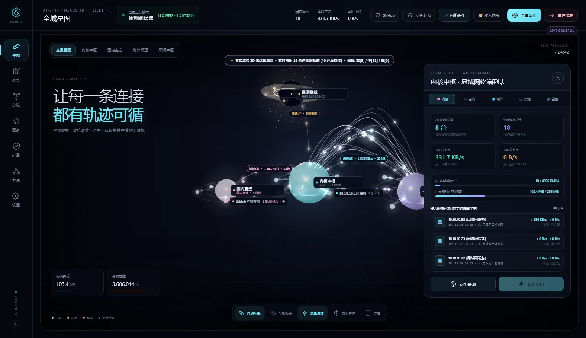

</div>

---

## 为什么选择 AI-LINK？

在传统的软路由与旁路由代理工具中，用户往往深陷于繁琐的配置、节点突然暴毙导致的断网、复杂的内网穿透折腾以及黑盒分流带来的无休止排错。

**AI-LINK 以解决真实用户痛点为核心**，采用现代化技术架构重构 OpenWrt 分流体验：
- **看得见** —— 独创 NEXUS 3D 宇宙星图，每个活跃会话的源 IP、分流策略、延迟与吞吐皆具象为流动光球；
- **分得清** —— 15 组策略独立出口，四阶走向查询彻底告别黑盒分流；
- **断不了** —— 智能看门狗自动保活、内核离线毫秒级拆除黑洞、DNS 自动降级自愈。

---

## 核心王牌功能：用解决用户问题的方式重塑体验

### 1. 🎯 自动节点池 (Auto Node Pool v2) —— 告别手动挑节点与卡顿掉线

> **用户痛点**：
> - 追剧看 4K 视频、远程会议或在线游戏进行到一半，节点突然死掉，只能停下手头的事登录路由器后台手动切换？
> - 订阅里有上百个节点，一个个测试费时费力，很多标注低延迟的节点实际速度极慢？
> - 网络轻微抖动就触发频繁重连，导致网页报错、会话中断或登录状态丢失？

**AI-LINK 解决方案与核心优势**：
- **毫秒级故障感知与无缝平滑自愈**：后台守护进程基于真实应用流量与轻量化周期探测持续巡检。一旦检测到当前节点宕机或丢包恶化，系统自动在毫秒级平滑切至备用健康节点，TCP 关键业务零感知、不掉线。
- **多维综合测速与动态评分模型**：摈弃单纯 ICMP ping 的虚假数据，采用真实 TCP/TLS 握手延迟、下行吞吐与历史滑动成功率三维打分，剔除伪低延迟死节点。
- **业务目标驱动的专属节点池**：支持按 AI / 视频流媒体 / 游戏 / 下载等不同业务场景建立专属独立节点池；支持「一键按延迟筛选 Top 10」智能建池，将好节点物尽其用。
- **防假死雪崩与并发内存水保护**：历史可用节点具备跨周期记忆，杜绝偶发抖动误判；500+ 节点超大订阅测速自动采用内存水位动态配额与请求限频，确保软路由低配硬件永不 OOM。
- **手动/自动正交解耦**：用户手动锁定的节点享有绝对控制权，即使不可用也严格保态不漂移；动态切换全部收敛于节点池内，绝不干扰用户自定义配置。

---

### 2. 🛡️ 全域安全防护 (Security Shield) —— 告别 DNS 劫持、泄漏与内网隐私窥探

> **用户痛点**：
> - 运营商劫持 DNS，频繁弹出恶意广告或被诱导重定向至未知网页？
> - 访问特定站点发生 DNS 泄漏，内网设备真实 IP 与访问轨迹暴露无遗？
> - 局域网接入摄像头、NAS、智能家居等敏感设备，担心被公网扫描刺探或恶意挖矿流量潜伏？

**AI-LINK 解决方案与核心优势**：
- **双层深度 DNS 净网防御体系**：在 DNS 解析层（`REFUSED` 拒绝）与网络路由层（`REJECT` 拦截）构建双重滤网，内置 50,000+ 条广告过滤、恶意重定向、隐私追踪与钓鱼规则，在网关入口处直接阻断威胁。
- **Fake-IP 真实地址脱敏与全链路防泄露**：内置高抗阻 Fake-IP 地址池，杜绝任何本地 DNS 查询泄露；提供 Strict / Loose / Off 三档专用 IPv6 防泄漏机制，完美解决旁路由 IPv6 旁路旁逃逸难题。
- **网络医生 (Network Doctor) 8 项并发并发体检**：秒级并发诊断 DNS 归属污染、AAAA 记录异常、IPv6 绕过、DDNS 状态、端口暴露、上游连通性、MTU 匹配与核心应用健康度，发现隐患支持一键自动修复。
- **局域网安全鉴权与内核黑洞熔断**：控制台支持局域网访问鉴权，API 敏感凭据全量脱敏；当后台内核异常退出时，看门狗在 1 秒内自动拆除全部透明代理链与黑洞策略，立即无缝降级为纯净直连，绝不因插件故障瘫痪全屋网络。

---

### 3. 🏠 加密回家隧道 (HomeLink) —— 告别无公网 IP 与复杂穿透，一键直连家庭内网

> **用户痛点**：
> - 出差、旅游或在办公室，急需访问家中的群晖 NAS 文档、私有云相册或管理智能家居，但宽带根本没有公网 IPv4 地址？
> - 第三方内网穿透限速严重、配置极其繁琐，且隐私数据需要经过第三方服务器中转？
> - 动态 DDNS 经常解析延迟，配置端口转发不仅步骤繁琐还极易将内网服务暴露在公网攻击下？

**AI-LINK 解决方案与核心优势**：
- **前沿高性能加密隧道直连**：内置最新一代 Hysteria2（基于 UDP/QUIC）与 VLESS-Reality 穿透协议，抗弱网抖动能力极强，在无公网 IPv4 的复杂宽带环境下也能实现极速直连。
- **零门槛扫码即连**：无需繁琐的端口映射与复杂配置，在管理面板一键生成回家节点，手机/笔记本扫描二维码或一键复制标准协议链接即可立即导入客户端。
- **三种灵活边界的内网反向分流**：
  - *局域网专用*：仅转发家庭内网网段（192.168.x.x / 10.x.x.x），在外访问家中 NAS 的同时，外部设备访问互联网继续使用当前所在网络；
  - *全量家庭代理*：将外部设备所有流量安全加密导入家中网关，出差在外也能安全享用家庭宽带的稳定连接与全局分流策略；
  - *自定义路由*：支持按需灵活指定访问网段。
- **企业级端到端安全加密**：纯点对点私有加密传输，无任何第三方中转，真正保障家庭核心资产、个人照片与监控数据的绝对隐私安全。

---

## 插件全功能矩阵 (Complete Feature Matrix)

AI-LINK 集成了涵盖从底层内核到交互表现的全栈功能，功能模块全景如下：

| 功能大类 | 核心模块 | 详细能力与功能特性 |
|---|---|---|
| **智能分流引擎** | 15 组策略分流 | 预置 AI (ChatGPT/Claude/Gemini/Copilot)、YouTube、TikTok、Netflix/Disney+、Google、GitHub、Microsoft、Apple、Steam/游戏平台、国内直连、黑洞拦截等 15 组专属 Shunt，支持优先级逐级匹配 |
| | 四阶走向查询 | 输入任意域名或 IP，秒级推演其四阶命中规则、归属分流组、出站节点与最终出站 IP，排错透明直观 |
| | 动态规则与分流降级 | 支持规则未命中兜底策略，支持外部规则源网络中断时自动退回安全规则 |
| **内核数据面** | 高性能单内核 | 基于 sing-box 1.14.1 现代化单内核，内存占用极低，调度开销较传统架构降低 40% 以上 |
| | 受控三模数据面 | 自由切换 `tproxy_redirect`（经典默认透明代理）、`tproxy_tcp_tun_udp`（游戏混合模式）与 `tun_full`（全量虚拟网卡 TUN 模式） |
| | 防掉线看门狗 | `respawn` 无限重试机制 + 15 秒进程看门狗；内核异常崩溃自动重启，离线自动拆除规则与恢复上游 |
| **3D 星图可视化** | NEXUS 3D 拓扑 | 呈现内核中枢、国内直连、海外代理、黑洞拦截四颗母星，节点为环绕卫星，连线按真实吞吐实时律动 |
| | 真实连接轨迹穿梭 | 动态捕获活跃网络连接，在星图上实时绘制 `终端 → 内核 → 母星 → 出口` 的 3D 抛物线光弧与流动光球 |
| | 三挡流速引擎 | 真实速率自适应：高 (`0.56`) / 中 (`0.26`) / 低 (`0.095`) 速率挡位，光球速度、大小与粒子拖尾随带宽实时变化 |
| | 概览交互卡片 | 终端设备、出站节点、分流规则三张核心 KPI 卡片，点击均可展开多维筛选、排序与快捷控制面板 |
| **自动节点池** | 智能健康巡检 | 后台多线程并发健康巡检，真实握手延迟、连通性与滑动成功率综合动态计分 |
| | 故障秒切与自愈 | 运行中节点死线自动平滑迁移至备用节点；防震荡冷却机制避免节点频繁横跳 |
| | 目标驱动优选 | 支持按地区、业务模式与延迟筛选自动建池；支持「一键测速挑选最快 10 个节点」加入优选池 |
| | 节点池六步向导 | 筛选勾选 → 只测新选 → 两段式加入 → 行内移除 → 往返微调 → 保存生效，全流程交互闭环 |
| **订阅与节点管理**| 11 种全格式解析 | 完美兼容 Clash（单块/嵌套/锚点 YAML）、V2Ray/Xray、sing-box JSON、Surge、Loon、SIP008、Base64 等主流格式 |
| | 订阅智能更新与同步 | 支持单条同步、一键全量同步、保存并同步，提供 3 阶段可视化进度条反馈 |
| | 订阅 Diff 与清洗 | 订阅更新前后对比预览（新增、变更、删除）；前置过滤非法端口与空 host，拒绝垃圾节点污染池子 |
| | 批量操作与节点重构 | 支持按地区/协议/延迟多选批量测速、启用/禁用、批量删除；自定义节点重命名与备注 |
| **全域安全防护** | 双层 DNS 拦截 | DNS 协议层 `REFUSED` 拒绝解析 + 防火墙路由层 `REJECT` 拦截，内置 50,000+ 条防广告防追踪规则库 |
| | 隐私保护与防泄漏 | Strict / Loose / Off 三档 IPv6 防泄漏机制；Fake-IP 地址池完全隔离本地真实 DNS 查询 |
| | 局域网访问鉴权 | 面板支持内网登录鉴权密码保护，对公网/外部请求凭据脱敏，杜绝嗅探与越权 |
| | 危险操作安全确认 | 12 项系统级敏感操作（重置、清空、内核重启等）支持二次弹窗确认，并支持操作后一键撤销还原 |
| **加密回家隧道** | 多协议服务端支持 | 内置 Hysteria2 (QUIC) 与 VLESS-Reality 高性能穿透协议，支持自动生成自签名安全证书 |
| | 二维码与一键配置 | 一键生成专属客户端导入二维码、标准 URL 链接与 Clash/sing-box 客户端配置模板 |
| | 三种路由边界隔离 | 灵活支持「仅访问家庭内网」、「全量家庭流量代理」与「自定义网段直连」三种安全拓扑 |
| **运维与网络体检**| 8 项并发网络体检 | 智能网络医生一键检测 DNS 劫持、AAAA 记录、IPv6 泄漏、DDNS、外网端口暴露、MTU 与关键应用健康 |
| | 极简接入向导 | 自动探测网络拓扑（主路由 / 旁路由 / 单臂路由 / Docker 容器），3 步式配置并自动进行双向连通性复检 |
| | 历史配置快照与回滚 | 关键操作前自动创建配置快照，提供版本对比视窗，支持「撤销此变更」与「一键恢复历史版本」 |
| | 多通道事件告警 | 支持 Webhook、Telegram Bot、SMTP 邮件告警通道，覆盖节点宕机、内核崩溃、规则更新等 7 类事件 |
| | 诊断包一键脱敏导出 | 一键打包内核状态、网络接口、路由表与守护进程日志，关键敏感 Token 自动正则脱敏，便于排障 |
| **UI 终端适配** | 全响应式布局 | 针对 430px (iPhone Pro Max)、375px (标准手机)、768px (iPad/平板) 及 PC 宽屏深度适配，零横向溢出 |
| | 现代化设计系统 | 统一发光主核、光子轨道与实时 KPI 横幅设计语言；深色高对比度太空科技美学，原生支持无障碍辅助 |
| | 双架构控制入口 | 既支持深度嵌入 OpenWrt LuCI 原生后台，也支持 9099 独立端口极速运行现代化 SPA 独立看板 |

---

## 界面一览

<div align="center">

| 01 全域 3D 星图 | 02 网络概览 | 03 代理与分流 |
|---|---|---|
| 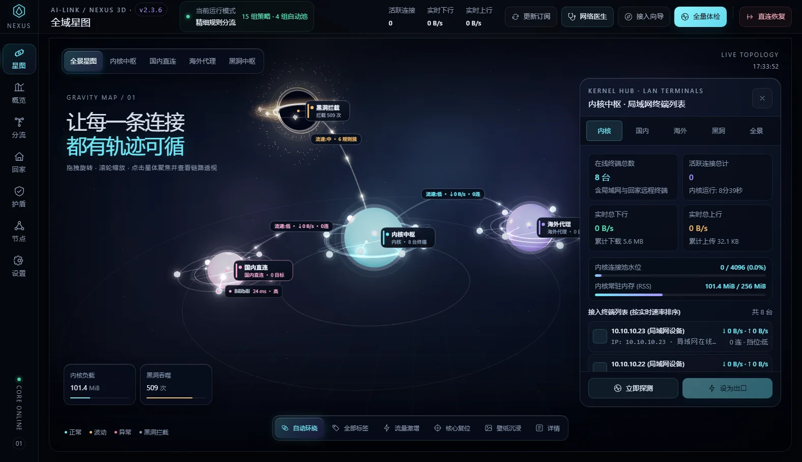 | 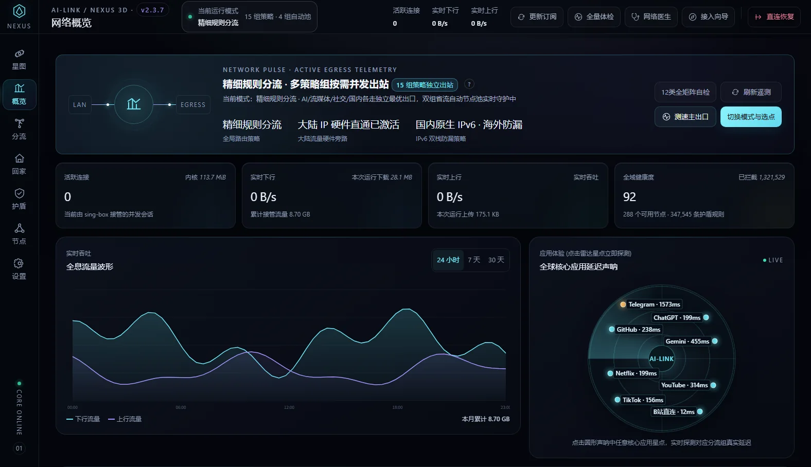 | 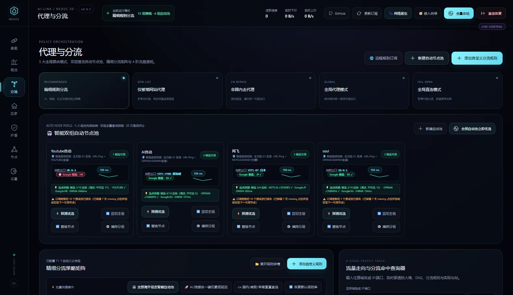 |

| 04 回家节点 | 05 DNS 与安全护盾 | 06 订阅与节点管理 |
|---|---|---|
| 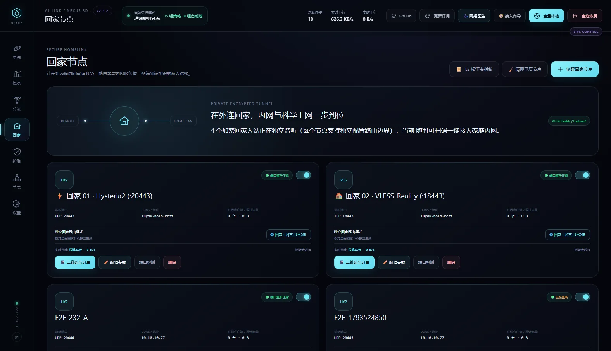 | 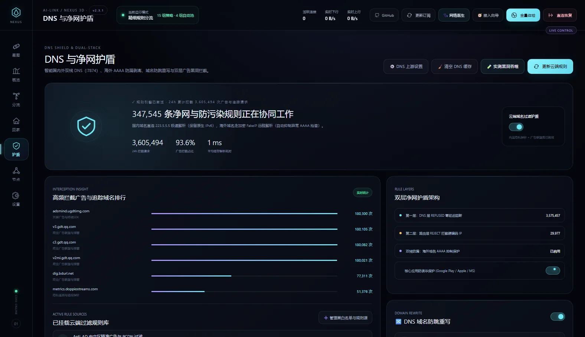 | 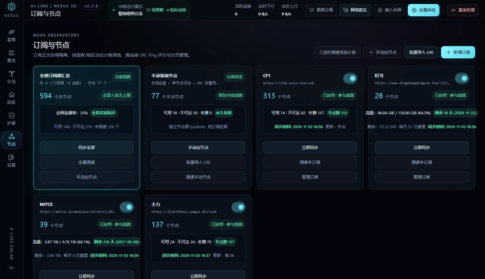 |

| 07 规则块与高级设置 | 自动节点池配置 | 移动端适配展示 |
|---|---|---|
| 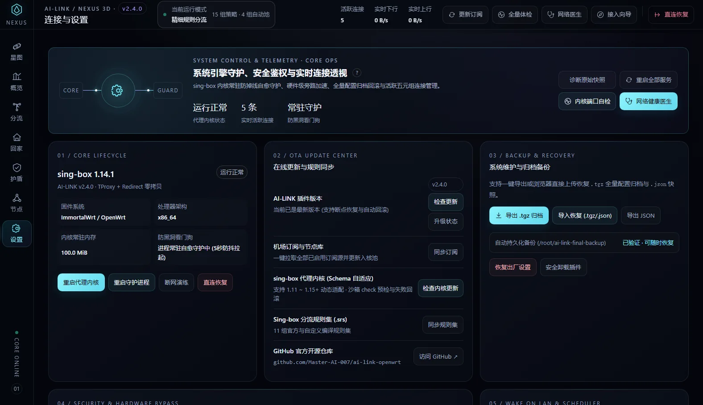 | 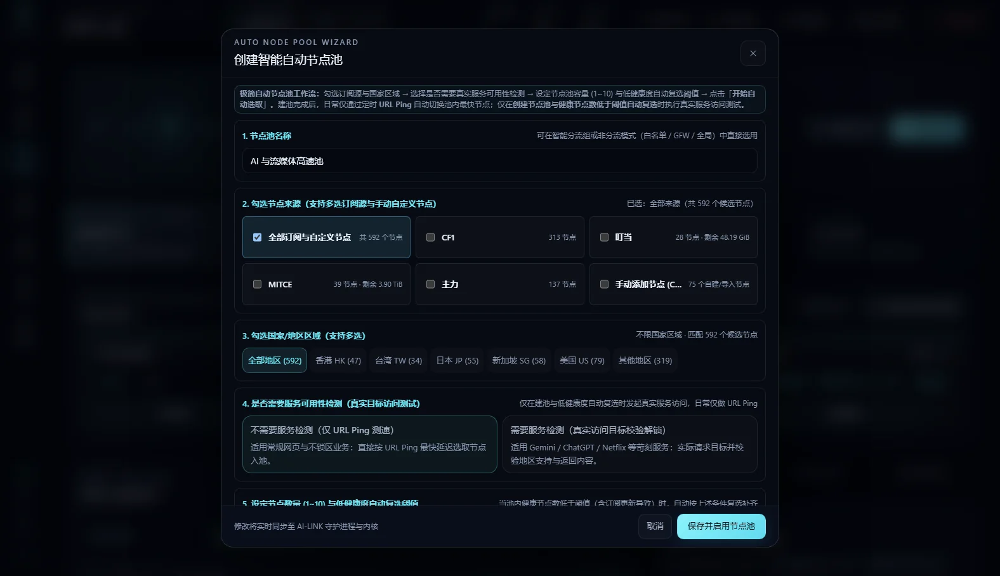 | 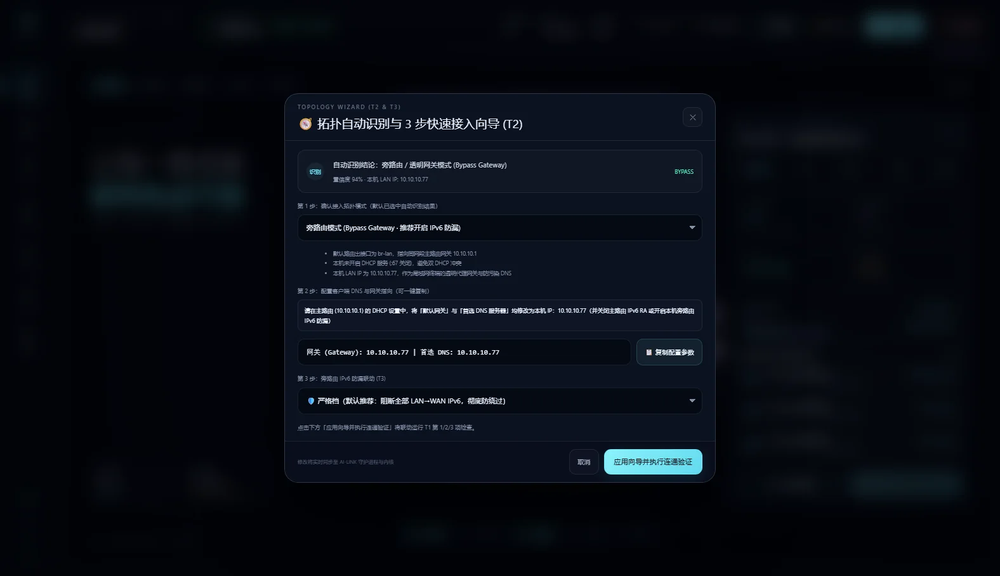 |
| 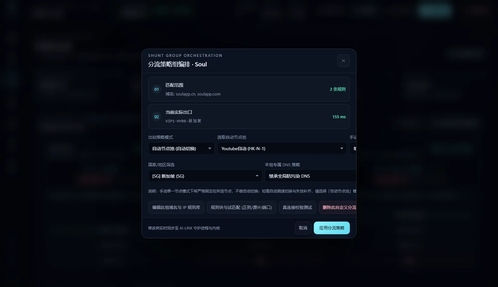 | 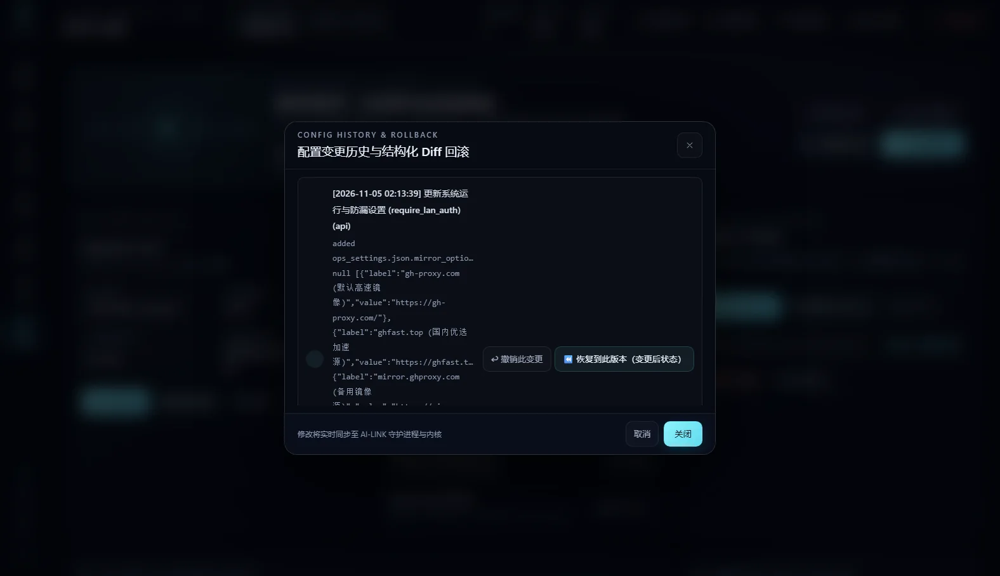 | 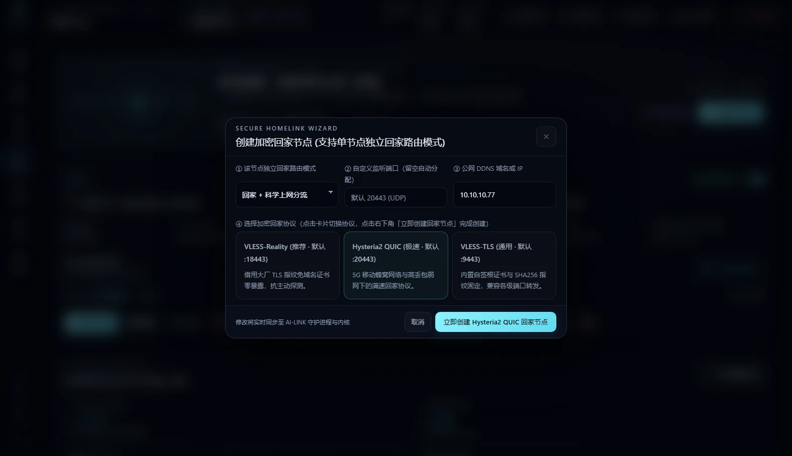 |

</div>

---

## 快速开始

### 环境要求

- **操作系统**：OpenWrt **23.05+ / 24.10 / ImmortalWrt 25.x**（基于 `fw4` + `nftables`，支持 `opkg` 与 `apk`）
- **CPU 架构**：`x86_64` / `aarch64` / `armv7` / `mipsel` / `riscv64`
- **硬件要求**：至少 32 MB 可用 Flash 存储空间；建议运行内存 ≥ 256 MB

### 一键安装

在路由器终端运行以下安装脚本：

```sh
curl -fsSL https://ai-link-official.pages.dev/install.sh | sh
```

> **说明**：安装脚本会自动识别软路由系统架构、包管理器类型，安全清理可能冲突的历史代理残留，下载并严格核验当前系统适配的离线安装包，安装完毕后自动完成内核运行与端口状态冒烟自检。

### 无损更新

```sh
# 已安装用户可通过终端一键无损检测并安全升级（具备配置快照回滚保护）：
ai-link update --apply

# 或通过在线更新脚本升级：
curl -fsSL https://ai-link-official.pages.dev/upgrade.sh | sh
```

### 状态自检

```sh
ai-link check                   # 快速自检 daemon / core / nft / 端口 / 出口连通性
ai-link status                  # 查看面板与内核当前实时状态
```

安装完成后，在浏览器中打开：`http://<路由器内网IP>:9099` 即可进入 AI-LINK NEXUS 控制台。

---

## 技术架构

```
LAN 局域网客户端设备
   │  DNS 请求 → dnsmasq → 127.0.0.1:7874 (FakeIP 198.18.0.0/15)
   ▼
nftables 防火墙 (table inet ai_link)
   ├── TProxy   :7893   (TCP / UDP 透明代理数据面转发)
   ├── redirect :7891   (DNS 劫持拦截)
   └── MSS clamp / 内网保留网段直连直通
   ▼
sing-box 1.14.1（高性能核心中枢）
   ├── 15 组专属 Shunt 选择器（AI / 视频 / 游戏 / GitHub / 办公 / 直连 …）
   ├── 自动节点池（多组候选池、延迟与成功率滑动综合评分、自愈秒切）
   └── 出站协议栈：VLESS-Reality / Hysteria2 / Shadowsocks / Trojan / 直连 / 黑洞 REJECT
```

---

## 版本发布与更新记录 (Releases)

为了保持主页清晰简洁，所有历史发布版本、源码更新记录、构建产物（`.ipk` / `.tar.gz`）及每个版本的详细变更说明已全部归档至 GitHub Releases：

👉 **前往查看全量版本发布记录**：[**GitHub Releases · AI-LINK Releases**](https://github.com/Master-AI-007/ai-link-openwrt/releases)

- 每一期 Release 均包含完整变更日志、SHA-256 校验指纹与自动化真机验收测试报告；
- 官方网站更新日志亦可同步查阅：[官网更新日志](https://ai-link-official.pages.dev/changelog)。

---

## 安装包指纹验证

最新候选构建验证指纹：

```
AI-LINK-v2.7.0.tar.gz
size   1,206,010 B
md5    c7d77b789481f20223a6d24da96f73e3
sha256 aee4a04fd2853cb12cefe8612dd49528d9a3cf753f2d72ae83c77254a8a2f846
```

在线清单比对地址：<https://ai-link-official.pages.dev/version.json>

---

## 安全建议

1. **面板访问凭据**：管理面板默认信任局域网（`require_lan_auth=false`）。**若 9099 端口可能暴露至公网，请务必在「设置」中开启「强制内网登录」并修改初始密码。**
2. **凭据安全脱敏**：前端控制台不向浏览器写入任何持久化令牌 Cookie，所有对外的状态及诊断接口均已实施凭据脱敏。
3. **接口绑定限制**：生产环境中建议将控制台端口绑定至特定内网管理接口，禁止任意未信任网段访问。

---

## 许可与免责

本项目采用 [MIT 许可证](LICENSE)。

本项目仅用于**个人学习、网络技术研究与自有网络管理**。请严格遵守所在国家/地区的法律法规及网络服务商服务条款，不得用于任何违法用途。开发者不对使用者的任何行为及其所产生的后果承担连带法律责任。
